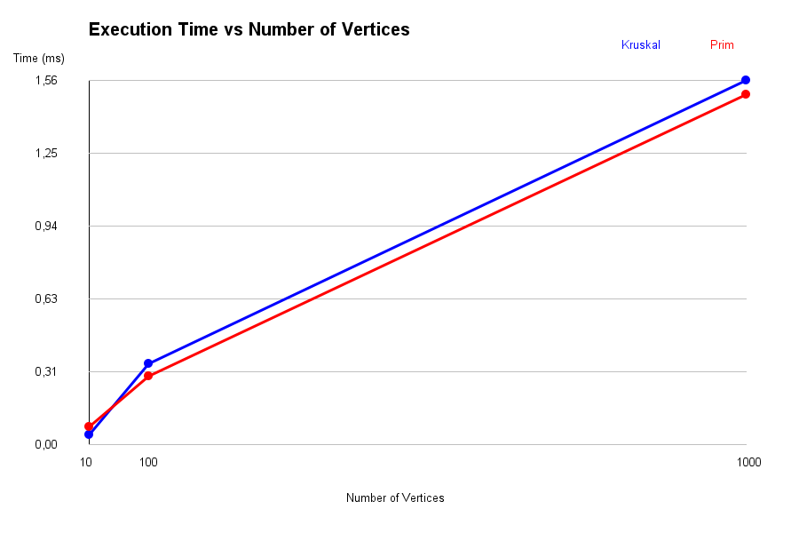
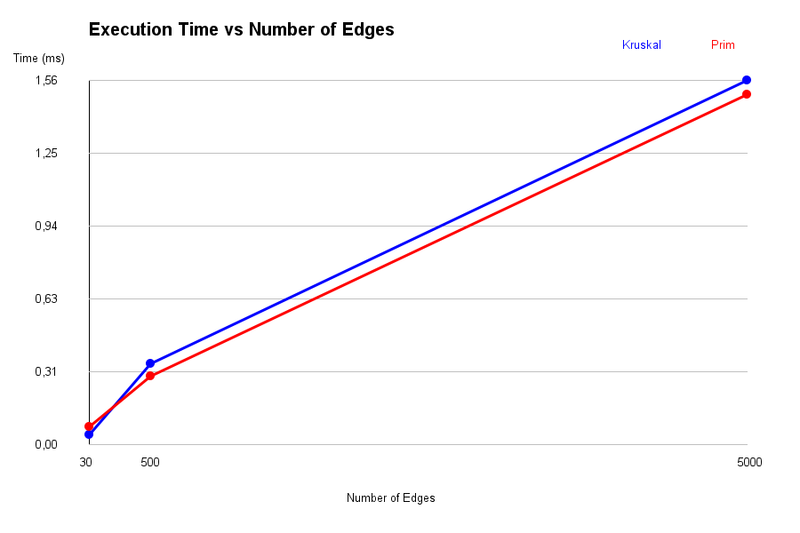

# Smart City Infrastructure and Route Planning

## Overview

This Java application models a smart city's infrastructure network using graph algorithms. It supports minimum-cost infrastructure planning, connectivity analysis, and shortest-route calculation.

The city is represented as a graph:

- Vertices represent districts or locations.
- Edges represent roads or infrastructure connections.
- Weights represent construction costs or travel distances.

The application implements DSU, Kruskal, Prim, topological sorting, Kosaraju SCC, and Dijkstra. It also includes reproducible graph generators, benchmarks, operation counters, automated tests, and performance plots.

## Implementation

### Requirements and Running

Requirements:

- JDK 25
- Maven 3.9 or newer

Run the following commands from the repository root:

```sh
mvn test
java -cp target/classes org.example.Main
```

The default application mode runs all experiments, exports the CSV, and generates both plots.

Optional modes:

```sh
java -cp target/classes org.example.Main benchmark
java -cp target/classes org.example.Main plots
```

- `benchmark` runs measurements and updates the CSV.
- `plots` generates plots from the existing CSV.
- `all`, or no argument, performs both steps.

In IntelliJ IDEA, select JDK 25 as the Project SDK. Run `AlgorithmTest` to execute the tests, then run `Main` with no arguments to reproduce the experiments. The working directory must be the repository root.

### Graph Representation

The `Edge` class stores the source vertex, destination vertex, and integer weight.

The `Graph` class stores weighted edges. MST algorithms accept an edge list and interpret each edge as undirected.

`DirectedGraph` stores directed connections using adjacency lists. Dijkstra builds a weighted directed adjacency list from the supplied edges.

### Disjoint Set Union

DSU uses:

- Path compression during `find`.
- Union by rank during `union`.

Kruskal uses DSU to avoid adding edges that would create a cycle.

### Minimum Spanning Tree

Kruskal sorts edges by weight and selects edges connecting different DSU components.

Prim starts at vertex 0 and expands the tree using a priority queue of candidate edges.

Both algorithms report:

- Total weight
- Connectivity status
- Selected edges
- Operation counts

For connected graphs, `selectedEdges` contains the edges of a spanning tree. For disconnected graphs, the result contains only the forest or partial tree found, and `connected` is false. The convenience method `findMST` returns `-1` when the graph is disconnected.

### Topological Sorting

Topological sorting uses Kahn's algorithm. Vertices with zero in-degree are processed first.

If fewer than V vertices can be processed, the graph contains a directed cycle. The result reports `hasCycle = true` and returns an empty ordering.

### Strongly Connected Components

Kosaraju's algorithm identifies SCCs using:

1. DFS to determine finishing order.
2. Construction of the reversed graph.
3. DFS on the reversed graph in decreasing finishing order.

Each vertex belongs to exactly one resulting component.

### Shortest Paths

Dijkstra uses a priority queue to calculate shortest distances from a selected source.

The implementation supports:

- Path reconstruction through parent pointers
- Unreachable vertices
- Input validation
- Rejection of negative edge weights

Unreachable distances are represented by `Long.MAX_VALUE`, and their reconstructed paths are empty.

Dijkstra requires non-negative weights because its greedy processing relies on the fact that extending a path cannot reduce its cost. Negative weights invalidate this assumption.

## Complexity Analysis

V is the number of vertices, and E is the number of edges.

The analysis assumes adjacency lists, binary-heap priority queues, and DSU with path compression and union by rank. The Prim and Dijkstra bounds below assume simple graphs.

| Algorithm | Time Complexity | Space Complexity |
|---|---|---|
| DSU find/union | O(α(V)) amortized per operation | O(V) |
| Kruskal | O(E log E + Eα(V)) | O(V + E) |
| Prim | O((V + E) log V) | O(V + E) |
| Topological Sort | O(V + E) | O(V + E) |
| Kosaraju SCC | O(V + E) | O(V + E) |
| Dijkstra | O((V + E) log V) | O(V + E) |

Space bounds include the graph representation and algorithm data structures.

### DSU

Path compression shortens paths to root vertices. Union by rank keeps trees shallow.

Together, these optimizations provide O(α(V)) amortized time per operation, where α is the inverse Ackermann function. Initializing the parent and rank arrays takes O(V) time and space.

### Kruskal

Sorting costs O(E log E). Processing edges with DSU costs O(Eα(V)).

The sorted edge list, DSU arrays, and selected tree edges require O(V + E) space.

### Prim

Building the adjacency list takes O(V + E).

This implementation stores candidate edges in the priority queue. The queue may contain O(E) entries, so heap operations cost O(log E). For simple graphs, log E is O(log V), giving O((V + E) log V) total time.

The adjacency list, queue, visited array, and selected edges require O(V + E) space.

### Topological Sort

Calculating in-degrees and processing vertices and edges takes O(V + E).

The graph, in-degree array, queue, and ordering require O(V + E) space.

### Kosaraju

Both DFS passes and graph reversal take O(V + E) time.

The reversed graph, visited arrays, finishing-order stack, recursive DFS stack, and components require O(V + E) space.

### Dijkstra

Building the adjacency list takes O(V + E). Successful distance updates create priority queue entries.

The implementation skips outdated queue entries. For simple graphs, the resulting bound is O((V + E) log V).

The graph, distance and parent arrays, and priority queue require O(V + E) space.

### Effect of Graph Size

Increasing V requires larger arrays and more vertex processing. Increasing E requires more edge examinations.

Kruskal also sorts edges, while Prim and Dijkstra perform heap operations. Topological sorting and Kosaraju have linear traversal complexity.

Measured times also depend on JVM compilation, allocation, garbage collection, and system load.

## Experimental Setup

### Graph Configurations

| Graph Size | Vertices | Edges |
|---|---:|---:|
| Small | 10 | 30 |
| Medium | 100 | 500 |
| Large | 1000 | 5000 |

### Graph Generation

All generators use a fixed random seed of 42.

For MST experiments, a chain connecting every vertex is created first. Additional random edges are then added until the required edge count is reached. This guarantees an undirected connected graph.

Weights are integers from 1 to 100. Duplicate undirected edges and self-loops are excluded.

Directed experiments use two graph types:

- DAG: every edge goes from a smaller vertex index to a larger one.
- Cyclic graph: the cycle 0 -> 1 -> 2 -> 0 is inserted first, followed by random directed edges.

Duplicate directed edges and self-loops are excluded.

For Dijkstra, the weighted edges from the connected graph generator are interpreted as directed edges. The initial chain 0 -> 1 -> ... ensures that every vertex is reachable from source 0 in these benchmarks. Unreachable vertices are tested separately.

### Measurement Procedure

For each graph configuration:

1. Generate graphs using seed 42.
2. Perform three warm-up runs per algorithm.
3. Perform five measured runs per algorithm.
4. Measure elapsed time using `System.nanoTime()`.
5. Calculate average time in milliseconds.
6. Average operation counts over the five runs.
7. Export the results to CSV and generate plots.

Graph generation is outside the timed sections. Algorithm-internal work, including adjacency-list construction or edge-list copying where applicable, is included.

The exporter checks that both MST algorithms report connectivity and equal total weights. It also checks successful DAG ordering and cycle detection.

The reported run used OpenJDK 25.0.1 on Windows through IntelliJ IDEA.

### Reproducibility

The fixed seed reproduces graph inputs and deterministic operation counts. Execution times vary between runs because of JVM behavior and machine load.

The tables below describe one benchmark execution containing five measured repetitions per algorithm and graph size.

Output files:

- `results/tables/benchmark_results.csv`
- `results/plots/time_vs_vertices.png`
- `results/plots/time_vs_edges.png`

### Operation Counters

| CSV Column | Meaning |
|---|---|
| `EdgesExamined` | Algorithm-specific edge examinations |
| `FindOperations` | DSU find calls, including recursive calls |
| `UnionOperations` | DSU union calls, including unsuccessful unions |
| `QueueOperations` | Priority queue insertions and removals |
| `DfsVisits` | Vertex visits across both Kosaraju DFS passes |
| `OtherOperations` | Combined algorithm-specific counter retained for compatibility |

`OtherOperations` is:

- Find calls plus union calls for Kruskal
- Queue operations for Prim and Dijkstra
- DFS visits for Kosaraju
- Zero for topological sorting

Inapplicable counters are zero. Different counter types represent different work and should not be treated as interchangeable units.

## Results

All execution times are averages over five runs, in milliseconds.

### MST Performance

| Vertices | Edges | Kruskal (ms) | Prim (ms) |
|---:|---:|---:|---:|
| 10 | 30 | 0.044180 | 0.076420 |
| 100 | 500 | 0.347440 | 0.296360 |
| 1000 | 5000 | 1.562940 | 1.504760 |

### Dijkstra Performance

| Vertices | Edges | Dijkstra (ms) |
|---:|---:|---:|
| 10 | 30 | 0.036300 |
| 100 | 500 | 0.174880 |
| 1000 | 5000 | 1.132820 |

### Directed Graph Performance

| Vertices | Edges | Topological DAG (ms) | Topological Cyclic (ms) | Kosaraju SCC (ms) |
|---:|---:|---:|---:|---:|
| 10 | 30 | 0.026700 | 0.009060 | 0.052580 |
| 100 | 500 | 0.130520 | 0.053420 | 0.128380 |
| 1000 | 5000 | 0.659220 | 0.445920 | 1.226880 |

### MST Operation Counts

| V | E | Kruskal Edges Examined | DSU Find Calls | DSU Union Calls | Prim Adjacency Entries Examined | Prim Queue Operations |
|---:|---:|---:|---:|---:|---:|---:|
| 10 | 30 | 15 | 49 | 15 | 60 | 45 |
| 100 | 500 | 317 | 1194 | 317 | 1000 | 819 |
| 1000 | 5000 | 3106 | 11887 | 3106 | 10000 | 8145 |

### Dijkstra Operation Counts

| V | E | Edges Examined | Queue Operations |
|---:|---:|---:|---:|
| 10 | 30 | 30 | 22 |
| 100 | 500 | 500 | 294 |
| 1000 | 5000 | 5000 | 2858 |

### Directed Graph Operation Counts

| V | E | Topological DAG Edge Examinations | Topological Cyclic Edge Examinations | Kosaraju Edge Examinations | Kosaraju DFS Visits |
|---:|---:|---:|---:|---:|---:|
| 10 | 30 | 60 | 30 | 90 | 20 |
| 100 | 500 | 1000 | 500 | 1500 | 200 |
| 1000 | 5000 | 10000 | 5040 | 15000 | 2000 |

### Execution Time vs Number of Vertices



### Execution Time vs Number of Edges



Both plots compare Kruskal and Prim.

V and E increase together across the selected configurations. These plots show changes across graph sizes; they do not isolate the independent effect of V or E.

Full results are available in [Benchmark Results CSV](results/tables/benchmark_results.csv).

## Comparison and Discussion

### Kruskal vs Prim

Kruskal was faster on the smallest graph: 0.044180 ms compared with 0.076420 ms for Prim.

Prim was faster on the medium graph: 0.296360 ms compared with 0.347440 ms for Kruskal. It was also slightly faster on the largest graph: 1.504760 ms compared with 1.562940 ms.

These measurements do not establish a universal advantage. Kruskal includes sorting and DSU work, while Prim includes adjacency-list construction and priority queue processing.

Kruskal examined 15, 317, and 3106 sorted edges before completing the MST. Prim examined 60, 1000, and 10000 adjacency entries, counting both directions of undirected edges.

Kruskal's edge counter excludes sorting comparisons. Therefore, fewer examined edges do not necessarily mean less total computational work.

### DSU Optimizations

Path compression reduces the length of future find operations. Union by rank prevents unnecessarily deep trees.

The measured find counts include recursive calls. Union counts include attempts that find both endpoints already connected.

No unoptimized DSU implementation was benchmarked, so the benefit of these optimizations is explained theoretically rather than measured as a direct speedup.

### Strongly Connected Components

Kosaraju's average time increased from 0.052580 ms to 0.128380 ms and then to 1.226880 ms.

Its operation counts match its structure:

- E edge examinations in the first DFS
- E during graph reversal
- E in the second DFS
- 2V total DFS vertex visits

The recorded totals are therefore 3E edge examinations and 2V vertex visits. These counts agree with O(V + E) complexity.

The measured times do not need to scale by exactly the same factor because execution overhead and JVM behavior also contribute.

### Topological Sorting

For DAGs, Kahn's algorithm examines each edge during in-degree calculation and again while processing the ordering. The recorded counts are 2E.

For cyclic graphs, some vertices remain unprocessed. The recorded edge examinations were 30, 500, and 5040.

Cyclic inputs were faster in this run because processing stopped without traversing all vertices through the queue. This depends on graph structure and does not mean that cyclic inputs are always faster.

### Dijkstra

Dijkstra's average time increased from 0.036300 ms to 0.174880 ms and then to 1.132820 ms.

It examined all 30, 500, and 5000 directed edges because every vertex was reachable from source 0. Priority queue operations increased from 22 to 294 and then to 2858.

These increasing counts help explain the runtime growth. Separate unit tests cover unreachable vertices and negative-weight rejection.

### Theory and Measurement Limitations

The results show increasing runtime as graph size grows, which is consistent with increasing algorithmic work.

However:

- Only three graph configurations were measured.
- Each configuration used one fixed graph per graph type.
- V and E changed together.
- Only five measured repetitions were performed.
- Short measurements are sensitive to JVM compilation, garbage collection, and scheduling.

Operation counts provide a clearer description of deterministic work, while timings describe performance under the recorded execution conditions.

## Testing

The project contains 10 JUnit 5 tests.

| Test | Correctness Check |
|---|---|
| MST correctness | Both algorithms return the expected weight; selected edges form a connected, acyclic tree with the expected total weight |
| Disconnected graph | Both MST convenience methods report failure |
| DAG ordering | A known DAG produces the expected valid order |
| Directed cycle | Topological sorting reports a cycle |
| SCC correctness | A graph is partitioned into the expected components |
| Shortest path | Dijkstra returns the expected distance and reconstructed path |
| Unreachable vertex | Distance is `Long.MAX_VALUE` and the path is empty |
| Negative weight | Dijkstra rejects the input |
| Single vertex | MST weight is zero and the source path is valid |
| Equal weights and multiple MSTs | Both algorithms return the correct minimum total weight |

The automated verification of the updated code completed with:

- Tests run: 10
- Failures: 0
- Errors: 0
- Skipped: 0
- Build status: SUCCESS

Run the tests with:

```sh
mvn test
```

In IntelliJ IDEA, open `AlgorithmTest.java` and run the test class.

## Conclusion

The application implements the required graph algorithms for infrastructure planning, connectivity analysis, and route calculation.

Kruskal and Prim find minimum-cost spanning trees and report disconnected graphs. DSU supports efficient component management through path compression and union by rank.

Topological sorting detects dependency cycles. Kosaraju identifies mutually reachable groups. Dijkstra calculates distances and routes for non-negative weighted directed graphs.

The experiments used the required graph sizes, a fixed seed, three warm-up runs, and five measured repetitions. CSV results, operation counts, and two performance plots are included.

In the recorded run, Kruskal was faster on the smallest graph, while Prim was faster on the medium and large graphs. These findings depend on the selected inputs and execution conditions.

The algorithms serve different purposes:

- Kruskal and Prim: minimum-cost infrastructure networks
- DSU: component tracking and cycle prevention
- Topological sorting: dependency ordering
- Kosaraju: strongly connected component analysis
- Dijkstra: shortest routes with non-negative weights